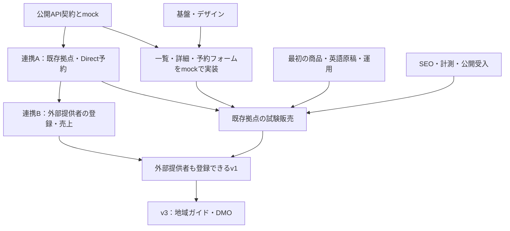

# Epic・着手順・担当への指示

作成日：2026-10-19。進捗の正本はGitHub Issue。設計の合意とIssue起票まで完了しており、各実装Issueは未着手。

## 全体像

| Epic | 成果 | 子Issue |
| --- | --- | --- |
| [基盤・デザイン・API契約](https://github.com/niho-life/niho-experience/issues/1) | 公開側だけで開発できる土台 | [開発基盤](https://github.com/niho-life/niho-experience/issues/5)、[デザイン](https://github.com/niho-life/niho-experience/issues/6)、[契約/mock](https://github.com/niho-life/niho-experience/issues/7) |
| [探す・比較する・予約する](https://github.com/niho-life/niho-experience/issues/2) | 旅行者の予約と提供者の入口 | [一覧](https://github.com/niho-life/niho-experience/issues/8)、[詳細](https://github.com/niho-life/niho-experience/issues/9)、[予約入力](https://github.com/niho-life/niho-experience/issues/10)、[提供者入口](https://github.com/niho-life/niho-experience/issues/11) |
| [商品・集客・公開受入](https://github.com/niho-life/niho-experience/issues/3) | 販売できる商品と測れる集客 | [SEO](https://github.com/niho-life/niho-experience/issues/12)、[最初の商品](https://github.com/niho-life/niho-experience/issues/13)、[計測/集客](https://github.com/niho-life/niho-experience/issues/14)、[公開受入](https://github.com/niho-life/niho-experience/issues/15) |
| [地域案内・DMOへの拡張](https://github.com/niho-life/niho-experience/issues/4) | v3の地域情報と他地域展開 | [地域ガイド](https://github.com/niho-life/niho-experience/issues/16)、[DMO運用](https://github.com/niho-life/niho-experience/issues/17) |

共通基盤側にも、連携Epicと「A：既存拠点の予約接続」「B：外部提供者の登録・共通売上」を起票済み。アクセス権のある担当は各Issueの依存リンクから参照する。

## 着手順



契約を待つ間も、デザインと商品準備は進められる。UIは仮契約のmockで作り始め、連携担当との契約合意後に版を固定する。外部提供者の登録はv1に必要であり、試験販売ができたことだけで省略しない。

## 推奨する3系統の分担

| 担当 | いま始めること | 次の作業 | 主に触る範囲 |
| --- | --- | --- | --- |
| 1：サイト・デザイン | [#5](https://github.com/niho-life/niho-experience/issues/5) / [#6](https://github.com/niho-life/niho-experience/issues/6) | [#8](https://github.com/niho-life/niho-experience/issues/8)→[#9](https://github.com/niho-life/niho-experience/issues/9)→[#10](https://github.com/niho-life/niho-experience/issues/10)、[#11](https://github.com/niho-life/niho-experience/issues/11)。SEO/計測の画面側実装と最終受入 | apps/web、表示部品、共通設定。最初は技術選定と画面設計 |
| 2：契約・NIHO連携 | [#7](https://github.com/niho-life/niho-experience/issues/7) | 共通基盤のA→Bを同じ担当が実装 | packages/api-client、fixture契約、NIHO共通基盤。DB/認証/決済はこの担当へ集約 |
| 3：商品・集客 | [#13](https://github.com/niho-life/niho-experience/issues/13) | [#14](https://github.com/niho-life/niho-experience/issues/14)、[#12](https://github.com/niho-life/niho-experience/issues/12)の検索/原稿/情報設計部分 | docs、原稿案、許諾管理、公開用コンテンツ。機密資料は指定の非公開保管先 |

統合・公開受入は担当1を窓口に、各担当が自分の証跡を揃える。NIHOappのmergeは同リポの既存merge担当・規約に従う。実際のGitHub assigneeは未指定。人またはチャットを割り当てる際に、この担当範囲を伝える。

### 競合を避ける約束

- 同じcheckoutを複数のチャットで編集しない。各担当は独立したbranch/作業ディレクトリを用意する。NIHOappではcanonical seatの手順を使う。
- package.json、lockfile、共通設定は担当1。API型・fixtureの構造は担当2。英語文言・商品の事実確認は担当3。担当外ファイルを触る前に範囲を合わせる。
- 担当1は本物のAPIがなくてもmockで進める。認証・決済サーバーを暫定的に別実装しない。
- NIHOapp側は原則A/B各1PR。公開画面の小変更に合わせてprivate側PRを量産しない。必要な仕様・migration・検証を同じ変更へ含める。
- 外部提供者への連絡、広告出稿、販売条件変更、本番公開は、該当の操作の授権と受入を確認してから行う。
- 新しいAPI要望は担当2へ集約する。依存関係の記録と受入結果はIssueへ残す。

## 担当へ渡す指示文

### 担当1：サイト・デザイン

```text
niho-life/niho-experience のサイト・デザインを担当してください。
最初に AGENTS.md、docs/architecture.md、docs/design-brief.md、docs/execution-plan.md を読み、次のIssueから進めてください。
基盤：https://github.com/niho-life/niho-experience/issues/5
デザイン：https://github.com/niho-life/niho-experience/issues/6

Slowhopの余白・写真・人の温かさを参考に、NIHO独自の英語体験予約サイトを作ります。
まず3〜5件の合成商品で一覧・詳細・予約入力を確認できるようにし、後続の画面Issueへ進めてください。
公開APIの型とmock構造は連携担当のIssueに合わせ、仮契約/本接続を明示してください。
共通設定はあなたが窓口です。NIHOappのコード、ログイン、決済、DBは変更せず、必要なAPI要望を連携Issueへまとめてください。
モバイル、読み込み/空/満席/失敗状態を含め、対象検証とレビュー可能なPRを作ってください。本番公開は受入後です。
```

### 担当2：API契約・NIHO連携

```text
niho-experience の公開API契約とNIHO共通基盤の連携を一貫して担当してください。
契約/mock：https://github.com/niho-life/niho-experience/issues/7
共通基盤側の連携Epic/連携A/連携Bは、このIssueと依存先のリンクから確認してください（private repoへのアクセスが必要）。

先に公開契約・mock・非公開情報の境界を決め、画面担当が独立して進められる状態にしてください。
次に既存拠点でのカタログ〜ゲスト予約〜Connect Direct〜確認を連携Aに集約し、外部提供者登録/所有権/口座再利用/売上管理を連携Bとして順番に実装してください。
NIHOアカウント、権限のあるPaymentEntityと既存Stripe口座、共通予約/台帳/返金を使います。口座の責任設定や決済モデルは変更しません。
NIHOapp側は原則2PRを目標に、契約を固めて対象検証後にPR化してください。必要な安全性テストや必須CIを省略してはいけません。
niho-appのAGENTS、data-ownership、canonical seat、safe PR/merge担当の規約を守ってください。公開側に内部スキーマ・PII・秘密を出さないでください。
```

### 担当3：商品・集客

```text
niho-experience の商品準備と販売導線を担当してください。
最初の商品：https://github.com/niho-life/niho-experience/issues/13
集客/計測：https://github.com/niho-life/niho-experience/issues/14
SEO：https://github.com/niho-life/niho-experience/issues/12

既存のコミュニティディナー等を候補に、最初の3〜5件について、英語原稿、写真の必要条件、提供者紹介、料金・日時・言語・取消/天候条件、運営分担を具体化してください。
確定している事実と、提供者/オーナーの確認待ちを分けてください。架空の体験や開催枠、レビューを実績として扱わないでください。
初期はNIHO/拠点、宿泊施設や地域案内、OTA、英語検索を組み合わせ、30日程度の検証計画と予約ファネルを作ってください。
検索量や競合は測定設定・出典を残し、未取得の数値は断定しないでください。広告/GSCの生データや個人の連絡先・契約は公開リポへ入れません。
コードの共通設定は担当1、API/確定売上は担当2と分担してください。営業送信・広告支出・販売条件変更・本番公開は、その操作の授権がない限り実行しないでください。
```

## 公開の区切り

| 区切り | 必要な状態 |
| --- | --- |
| モックプレビュー | 合成データで主要画面と状態が確認できる。実在予約を受け付けない |
| 既存拠点の試験販売 | 連携A、商品条件、SEO/計測、受入・運営準備が揃う |
| 外部提供者も使えるv1 | 上記に加え連携B、提供者登録・権限・口座再利用・売上管理の受入が済む |
| v3 | v1の販売・運営結果を基に地域情報と他地域機能を優先づける |

公開ドメイン、表示名、手数料/販売条件、提供者との契約、掲載素材等は本番公開前の確定事項。現時点で未確定でもモック開発と設計は進められる。
